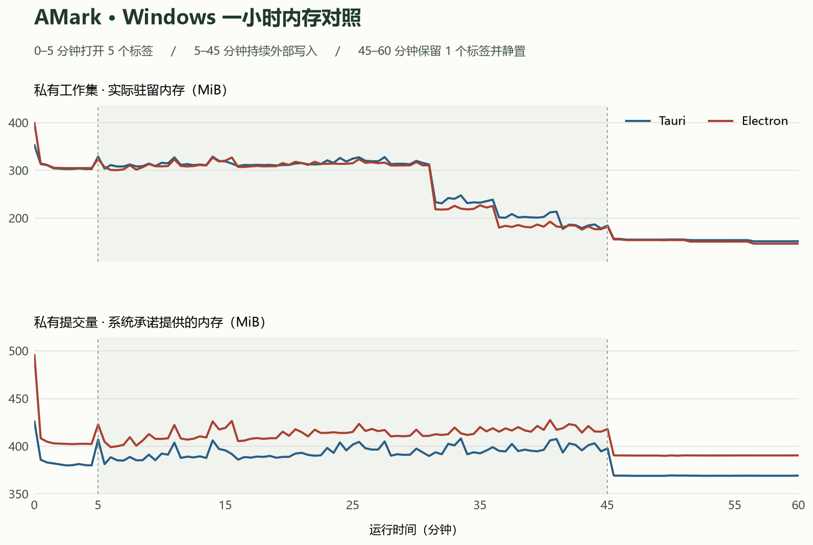

# AMark 在 Windows 真实工作区运行一小时的内存对照

2026-11-26 02:49（北京时间）开始。Tauri 0.1.1 和 Electron 0.2.0 在同一台 Windows 机器上同时运行。每 30 秒按进程树汇总一次，各取得 121 个采样点，下表为各阶段中位数，单位 MiB。差值用未四舍五入的中位数计算，为 Electron 减去 Tauri。

| 场景                   | Tauri 私有工作集 | Electron 私有工作集 | 差值 | Tauri 私有提交量 | Electron 私有提交量 |  差值 |
| ---------------------- | ---------------: | ------------------: | ---: | ---------------: | ------------------: | ----: |
| 5 个标签预览           |            303.3 |               304.4 | +1.1 |            380.9 |               402.4 | +21.4 |
| 5 个标签、持续外部写入 |            310.7 |               308.3 | -2.4 |            393.0 |               413.7 | +20.7 |
| 1 个标签、停止写入     |            153.3 |               150.3 | -3.0 |            368.8 |               390.1 | +21.3 |



持续写入阶段，两版的常驻内存中位数相差 2.4 MiB，Electron 的私有提交量高 20.7 MiB。全程采到的最高常驻内存均出现在首个采样点，Tauri 为 352.5 MiB，Electron 为 398.8 MiB。采样间隔为 30 秒，更短的峰值可能出现在两次采样之间。

两个进程树的工作集在第 45 分钟关闭标签之前就已经下降，而提交量仍在原有范围内。最后 15 分钟的阶段中位数同时受前期变化和关闭标签影响。

## 工作负载

- 取自真实决策工作区，54 篇 Markdown 原文共 122,250 字节。两个应用都读取同一份副本。另用最长的原文创建一份活动文档，每次写入替换结尾的修订编号。
- 两边在同一个隔离测试桌面各有一个 1600×952 的可见窗口。前 5 分钟保留 5 个标签并显示只读预览。第 5 至 45 分钟约每 10 秒写一次活动文档，一共 237 次。每次采样都核对两边预览显示相同的最新修订编号。最后 15 分钟停止写入并关闭 4 个标签。
- 以 Windows 性能计数器统计包括渲染和图形进程在内的完整子进程树。私有工作集是物理内存中各进程的专用页，私有提交量计入已经提交但可能未驻留的页。共享页和独立显存未计入。这次对照覆盖一台 Windows 机器、一次并行运行和一个工作区。

## 复核

[逐次采样](samples.csv) · [运行时间、浏览器版本及程序指纹](run.json) · [对照脚本](../../windows/compare.ps1)

在 Windows 上准备两个发行程序，给脚本传入至少包含四篇顶层 Markdown 文件的目录，以及一个新输出目录。脚本使用独立的浏览器配置，启动两个真实窗口，用文档副本接收写入。需要 PowerShell 7 和带 WebSocket 支持的 Node.js，如 Node.js 24。

```powershell
./benchmarks/windows/compare.ps1 -TauriExe <旧版amark.exe> -ElectronExe <解包后的AMark.exe> -Workspace <Markdown目录> -OutputDirectory <新目录> -Minutes 60 -IntervalSeconds 30
```
